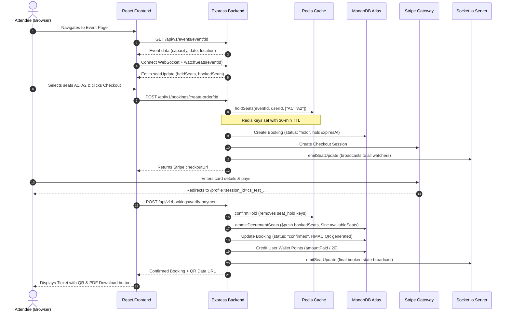

# File 01: EventSphere From Zero

This document introduces EventSphere as if you are encountering the system for the very first time. It explores the core problem the platform solves, the personas that interact with it, the architectural flow from click to database, and the mental models needed to discuss the system in technical interviews.

---

## 1. What is EventSphere?

**EventSphere** is a full-stack event discovery, seat-reservation, and ticketing platform. It provides end-to-end functionality for searching live experiences, viewing interactive seat maps, holding seats temporarily during checkout, executing payments through Stripe or wallet points, receiving HMAC-signed QR tickets, and engaging in real-time chat with fellow attendees.

In traditional event systems, high-demand sales (such as concert drops or movie premieres) suffer from race conditions where multiple users purchase the same physical seat at the exact same millisecond. EventSphere addresses this with a **three-tier concurrency model** combining in-memory Redis holds, atomic MongoDB document operations, and WebSocket state broadcasts.

```
+-----------------------------------------------------------------------------------+
|                                    EVENTSPHERE                                    |
|                                                                                   |
|  +------------------+    +-------------------+    +----------------------------+  |
|  |     Attendee     |    |     Organizer     |    |           Admin            |  |
|  | Discover, select |    | Create & publish  |    | Global catalog oversight,  |  |
|  | specific seats,  |    | events, track     |    | event deletion, system     |  |
|  | pay via Stripe/  |    | revenue charts,   |    | integrity maintenance      |  |
|  | wallet, chat     |    | scan QR tickets   |    |                            |  |
|  +------------------+    +-------------------+    +----------------------------+  |
+-----------------------------------------------------------------------------------+
```

---

## 2. The Core Problem EventSphere Solves

Building a production ticketing platform requires solving four fundamental engineering challenges:

1. **Overselling & Concurrency Races**: If 50 people click "Buy" on seat `A1` at 10:00:00 AM, only one buyer should proceed. The other 49 must be notified immediately without corrupting inventory or creating double-bookings.
2. **Abandoned Carts & Cart Freezing**: When a user selects a seat and enters checkout, that seat must be temporarily reserved so no one else can take it. However, if the user closes their browser or loses internet, the seat cannot remain locked forever; it must expire and automatically return to the public pool.
3. **Ticket Counterfeiting & Gate Fraud**: Plain ticket images or sequential IDs (`/ticket/1024`) can be forged or shared. EventSphere issues cryptographically signed QR codes verified using HMAC-SHA256 secret keys at the gate.
4. **Community Isolation**: Ticketing platforms often treat events as purely transactional. EventSphere automatically provisions WebSocket-powered community chat rooms for confirmed attendees.

---

## 3. Real-World Personas and Use Cases

EventSphere defines three distinct user roles in its data model (`backend/models/user.model.js:23-28`):

### 1. The Attendee (`role: "attendee"`)
- **Discovery**: Browses active events filtered by category (Movie, Music, Workshop, Sports, Other).
- **Seat Selection**: Views an interactive seat map with real-time color indicators (Available, Selected, In Cart, Booked).
- **Checkout & Rewards**: Applies discount coupons (`SPHERE20`, `WELCOME10`, `FESTIVAL50`) or redeems loyalty wallet points (earning 5% cashback on paid orders).
- **Ticket Management**: Downloads tickets as client-rendered PDFs with embedded QR codes.
- **Community Chat**: Joins the real-time event community chat (access is strictly guarded—only confirmed ticket holders may participate).
- **Post-Event Reviews**: Submits 1-to-5 star ratings and written reviews once the event date has passed.

### 2. The Organizer (`role: "organizer"`)
- **Event Creation**: Publishes events with titles, descriptions, dates, venues, Google Maps coordinates, ticket tiers, capacities, and hero images uploaded to Cloudinary.
- **Analytics & Revenue**: Inspects real-time dashboards with Recharts bar charts showing ticket volume, seats occupied, and total gross revenue.
- **Event Lifecycle**: Edits event parameters or marks events as `cancelled`.
- **Gate Check-In**: Scans attendee QR codes at venue doors via the `/api/v1/bookings/checkin` endpoint.

### 3. The Administrator (`role: "admin"`)
- Inherits all organizer privileges.
- Possesses global authorization to inspect all bookings system-wide (`/api/v1/bookings/admin/all-bookings`).
- Maintains platform integrity by permanently deleting offending events and images from Cloudinary (`/api/v1/events/admin/delete-event/:id`).

---

## 4. The Complete User Journey

The life of an event booking spans four coordinated subsystems:



---

## 5. The Real-World Mental Model

Think of EventSphere as a **Modern Multiplex Box Office**:

| Real-World Concept | EventSphere Implementation | Code Reference |
| :--- | :--- | :--- |
| **Physical auditorium seating** | MongoDB `Event` document with `capacity`, `availableSeats`, and `bookedSeats: [String]` | [event.model.js](../../backend/models/event.model.js#L71-L87) |
| **Clerk placing fingers on seats while you pull out cash** | Redis key `seat_hold:{eventId}:{seatId}` with 30-minute expiry | [seatHold.js](../../backend/utils/seatHold.js#L13-L74) |
| **Electronic display board outside auditorium updating instantly** | Socket.io room `seats:{eventId}` broadcasting `seatUpdate` events | [socket.js](../../backend/socket.js#L57-L89) |
| **Credit card terminal** | Stripe Checkout Session hosted payment flow | [booking.controller.js](../../backend/controllers/booking.controller.js#L211-L241) |
| **Multiplex rewards card** | MongoDB `User.walletPoints` earning 5% cashback on ticket spends | [user.model.js](../../backend/models/user.model.js#L33-L37) |
| **Tamper-proof physical ticket barcode** | HMAC-SHA256 signed QR code with cryptographic digest | [booking.controller.js](../../backend/controllers/booking.controller.js#L69-L78) |
| **Lobby usher scanning ticket at auditorium entrance** | Express check-in route executing cryptographic hash verification | [qrScan.middleware.js](../../backend/middlewares/qrScan.middleware.js#L14-L39) |
| **Auditorium lounge for ticket holders** | Socket.io room restricted to users with confirmed bookings | [socket.js](../../backend/socket.js#L97-L125) |

---

## 6. How the Subsystems Connect

```
+-----------------------------------------------------------------------------------------+
|                                    CLIENT LAYER                                         |
|  React 19 (Vite)  •  Tailwind CSS v4  •  Redux Toolkit  •  Socket.io Client  •  Lucide   |
+-----------------------------------------------------------------------------------------+
                                           │
                    HTTP REST Requests     │     WebSocket Bi-directional
                    (Axios with Cookies)   │     (WebSockets / Polling)
                                           ▼
+-----------------------------------------------------------------------------------------+
|                                   BACKEND RUNTIME                                       |
|  Node.js 20.x  •  Express 5.1.0  •  Socket.io Server  •  Node-Cron (Hold Expiry)        |
|                                                                                         |
|  +-------------------+  +-------------------+  +-------------------+  +--------------+  |
|  | Rate Limiters     |  | Auth Middleware   |  | Business Services |  | Error Filter |  |
|  | (Auth & Bookings) |  | (Dual JWT Verify) |  | (Hold/Lock/Order) |  | (Uniform Res)|  |
|  +-------------------+  +-------------------+  +-------------------+  +--------------+  |
+-----------------------------------------------------------------------------------------+
            │                               │                              │
            ▼                               ▼                              ▼
+-----------------------+       +-----------------------+      +-----------------------+
|    PERSISTENT DATA    |       |      TRANSIENT        |      |   EXTERNAL SERVICES   |
|     MongoDB Atlas     |       |      MEMORY LAYER     |      |                       |
|                       |       |                       |      | • Stripe (Cards)      |
| • Users & Wallets     |       | • Upstash / ioredis   |      | • Cloudinary (CDN)    |
| • Events & Capacities |       |   (Seat holds, TTLs)  |      | • Razorpay (Refunds)  |
| • Bookings & QR codes |       | • In-memory fallback  |      |                       |
| • Reviews & Ratings   |       |   Map store           |      |                       |
+-----------------------+       +-----------------------+      +-----------------------+
```

---

## 7. What Is Implemented vs. What Is Inferred

To ensure you speak with precision in an interview, review the verified feature status:

### Verified in Code
- **Dual-Token JWT Authentication**: Access tokens (short-lived, 1 day default) and refresh tokens (10 days default) stored in HTTP-only cookies and MongoDB.
- **Seat Selection Grid**: Interactive 10-column seat matrix generated dynamically from event capacity.
- **3-Layer Concurrency Guard**: Redis seat reservation -> MongoDB atomic `$nin` guard -> Socket.io broadcast.
- **Hold Expiry Background Worker**: Node-cron job running every 60 seconds searching for expired holds and restoring seats.
- **Loyalty Wallet Points**: Deducts points during checkout and awards `Math.floor(amountPaid / 20)` upon payment confirmation.
- **Secure Ticket QR Generation**: HMAC-SHA256 signature generated over `bookingId:randomHex` using server secret `QR_SECRET`.
- **Gate Check-In Endpoint**: Validates QR hash and updates `checkedIn: true`.
- **Gated Community Chat**: Socket.io room joins require an active MongoDB booking with `paymentstatus: "confirmed"`.

### Important Code Nuances & Gaps
- **Payment Verification Trigger**: Payment confirmation occurs when the user's browser is redirected back to `/profile?session_id=...`. There is **no verified Stripe Webhook listener endpoint** in the backend routes; payment confirmation is driven by the client redirect.
- **Hold Expiry Argument Mismatch**: In `backend/jobs/holdExpiry.js:84`, the cron job calls `atomicRestoreSeats(booking.event, booking.seatsBooked)` (passing a Number) rather than an array of seat strings (`booking.selectedSeats`), which creates a discrepancy during array-based seat map cleanups.

---

## 8. Summary for Interviews

> "EventSphere is a high-concurrency event discovery and ticketing platform built with React, Node.js, Express 5, MongoDB, and Redis. It solves the classic e-commerce overselling problem using a three-tier architecture: transient seat holds in Redis prevent race conditions during a 30-minute checkout window; atomic MongoDB `findOneAndUpdate` updates with conditional guards provide ACID-level consistency at checkout; and Socket.io broadcasts live seat updates to all active clients. Tickets are secured with HMAC-SHA256 QR codes verifiable at the venue gate, and confirmed attendees gain access to exclusive real-time community chat rooms."
