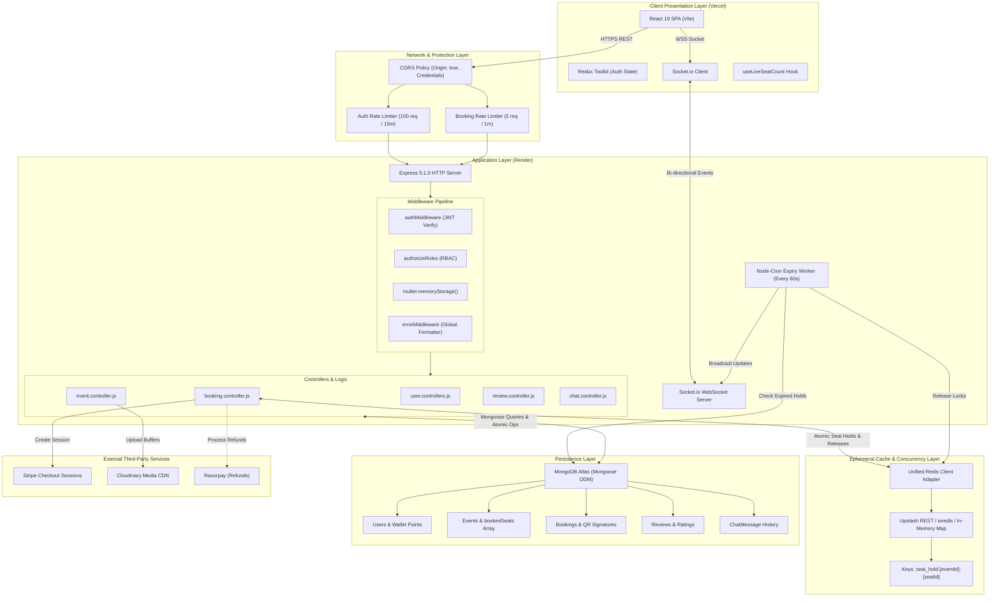
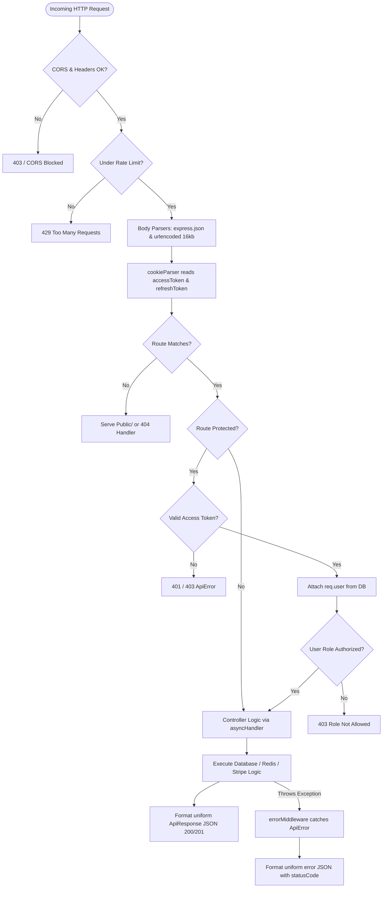
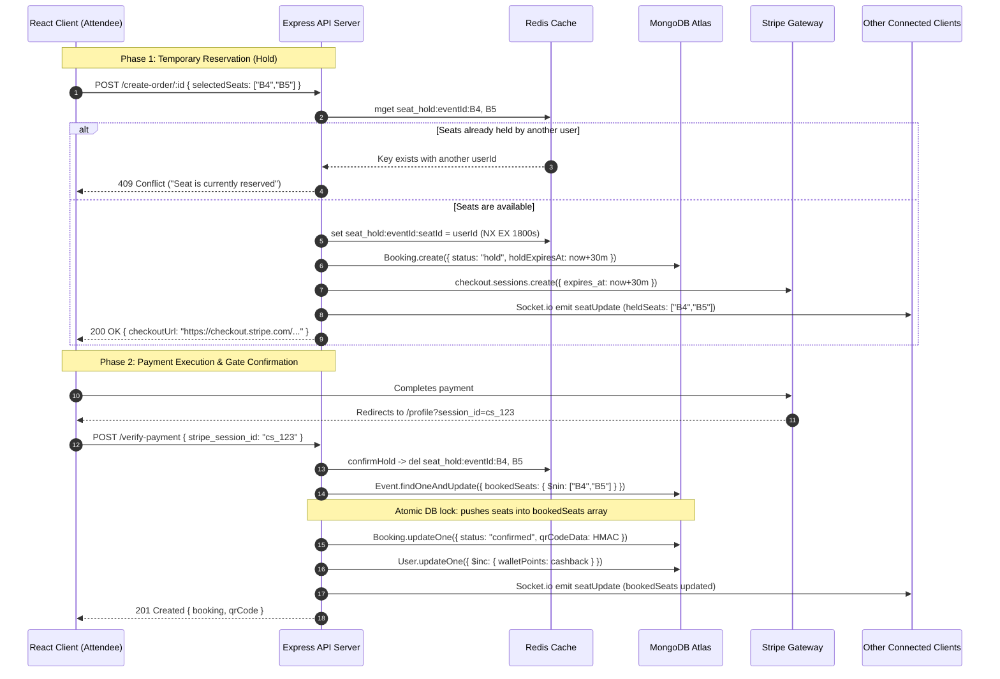

# File 03: System Architecture

This document details the complete system architecture of EventSphere. It explains how the frontend client, backend application server, database, in-memory cache, and external payment and media services interact across the entire application lifecycle.

---

## 1. High-Level Architectural Topology

EventSphere follows a **decoupled client-server architecture** with distinct layers for presentation, API routing and business logic, caching and concurrency coordination, and persistent data storage.



### Explanation of the Topology Diagram
1. **Client Layer**: The browser executes a lightweight React 19 Single Page Application. It maintains global authentication tokens in Redux Toolkit and opens two simultaneous communication channels: HTTPS requests via Axios and an active WebSocket connection via Socket.io-client.
2. **Network & Edge Layer**: Incoming requests pass through CORS filters allowing credentials. Rate limiters separate general authentication traffic from booking mutation traffic to stop brute force attempts and automated seat hoarding bots.
3. **Application Server Layer**: An Express 5 server handles REST routing. Middlewares parse JSON payloads, decode cookies, authenticate JWT signatures, and check role permissions (`attendee`, `organizer`, `admin`).
4. **Cache & Persistence**: Transient seat reservations are routed into Redis with automatic expirations, while persistent state (confirmed bookings, user wallets, event catalogs) is committed to MongoDB Atlas.
5. **Real-Time & Background Operations**: Socket.io broadcasts live inventory states to connected rooms, while a Node-Cron worker operates in the background to clean up abandoned carts.

---

## 2. Request-Response Lifecycle Pipeline

Every HTTP request to EventSphere flows through a strict, deterministic middleware chain:



### Explanation of the Pipeline
- **Body & Cookie Parsing**: Payloads are capped at `16kb` to protect against Denial of Service memory exhaustion attacks ([app.js:46-47](../../backend/app.js#L46-L47)). Cookies are decoded using `cookie-parser`.
- **Protected Route Guards**: If a route specifies `authMiddleware` ([auth.middleware.js](../../backend/middlewares/auth.middleware.js)), it extracts the token from either the HTTP-only cookie or the `Authorization: Bearer <token>` header, verifies the cryptographic signature with `ACCESS_TOKEN_SECRET`, fetches the user record without passwords, and attaches it to `req.user`.
- **Role-Based Access Control (RBAC)**: `authorizeRoles("organizer", "admin")` ([role.middleware.js](../../backend/middlewares/role.middleware.js)) checks `req.user.role`. If unauthorized, it rejects the request with HTTP 403 before any controller runs.
- **Async Handler & Error Middleware**: All controllers are wrapped in `asyncHandler` ([asyncHandler.js](../../backend/utils/asyncHandler.js)), capturing unhandled promise rejections and passing them to `errorMiddleware` ([error.middleware.js](../../backend/middlewares/error.middleware.js)), which standardizes responses into a uniform `{ success: false, message, errors }` format.

---

## 3. Communication Patterns

EventSphere relies on four distinct communication paradigms across its subsystems:

| Interaction Pattern | Protocol / Transport | Endpoints / Channels | Example Use Case |
| :--- | :--- | :--- | :--- |
| **Client-to-Server REST** | HTTP / HTTPS (JSON) | `/api/v1/events/*`<br>`/api/v1/bookings/*` | Fetching event details, submitting login credentials, creating orders |
| **Real-time Server-to-Client Broadcast** | WebSocket (Socket.io) | Room: `seats:{eventId}`<br>Event: `seatUpdate` | Broadcasting live seat counts to all users browsing an event |
| **Real-time Bi-directional Chat** | WebSocket (Socket.io) | Room: `{eventId}`<br>Events: `sendMessage`, `newMessage` | Confirmed attendees chatting, sharing typing indicators |
| **Asynchronous Background Scheduling** | In-process timer (node-cron) | Schedule: `* * * * *` (Every 60s) | Polling expired holds, releasing Redis keys, broadcasting seat returns |
| **Server-to-External Gateway** | HTTPS REST (Vendor SDKs) | Stripe API (`api.stripe.com`)<br>Cloudinary API | Generating checkout sessions, streaming image buffers, issuing refunds |

---

## 4. Authentication and Authorization Boundaries

EventSphere enforces strict boundary separation across different user tiers and endpoints:

```
+-----------------------------------------------------------------------------------------+
|                                    ACCESS BOUNDARIES                                    |
|                                                                                         |
|  PUBLIC BOUNDARY (No Auth Required)                                                     |
|  ├── GET  /api/v1/events/all-events                                                     |
|  ├── GET  /api/v1/events/event/:id                                                      |
|  ├── GET  /api/v1/bookings/seat-availability/:eventId                                   |
|  ├── POST /api/v1/users/register                                                        |
|  ├── POST /api/v1/users/login                                                           |
|  ├── POST /api/v1/users/refresh-token                                                   |
|  └── Socket: watchSeats(eventId)                                                        |
|                                                                                         |
|  AUTHENTICATED ATTENDEE BOUNDARY (Requires Valid Access Token)                          |
|  ├── GET  /api/v1/users/profile                                                         |
|  ├── POST /api/v1/users/logout                                                          |
|  ├── POST /api/v1/users/change-password                                                 |
|  ├── PATCH /api/v1/users/update-account                                                 |
|  ├── POST /api/v1/bookings/create-order/:eventId                                        |
|  ├── POST /api/v1/bookings/verify-payment                                               |
|  ├── GET  /api/v1/bookings/my-bookings                                                  |
|  ├── DELETE /api/v1/bookings/cancel-booking/:bookingid                                  |
|  ├── POST /api/v1/reviews/post-review/:eventId (Must have attended)                     |
|  ├── POST /api/v1/contacts/contact                                                      |
|  └── Socket: joinRoom(eventId) (Must have confirmed booking)                            |
|                                                                                         |
|  ORGANIZER BOUNDARY (Requires role: "organizer" or "admin")                             |
|  ├── POST  /api/v1/events/create-event (Multer image upload)                            |
|  ├── PATCH /api/v1/events/update-event/:id                                              |
|  ├── PATCH /api/v1/events/cancel-event/:eventid                                         |
|  ├── GET   /api/v1/events/my-events                                                     |
|  ├── GET   /api/v1/events/analytics/:eventid                                           |
|  ├── GET   /api/v1/bookings/organizer/event-bookings/:eventId                           |
|  └── POST  /api/v1/bookings/checkin (QR Code HMAC Gate Verification)                    |
|                                                                                         |
|  ADMIN BOUNDARY (Requires role: "admin")                                                |
|  ├── GET    /api/v1/events/admin/all-events (Includes inactive/cancelled events)       |
|  ├── DELETE /api/v1/events/admin/delete-event/:id (Destroys DB record & Cloudinary asset)|
|  ├── GET    /api/v1/bookings/admin/all-bookings (System-wide ledger)                   |
|  └── GET    /api/v1/bookings/admin/event-bookings/:eventId                             |
+-----------------------------------------------------------------------------------------+
```

---

## 5. Architectural Data Flow: The Seat Reservation & Payment Cycle

To understand the core architecture in action, observe how the system synchronizes state across Redis, MongoDB, Stripe, and Socket.io during a booking:



---

## 6. Architectural Weaknesses and Trade-offs

1. **Client-Driven Payment Verification**:
   - *Current Implementation*: Payment verification is triggered by the frontend redirecting to `/profile?session_id=...`.
   - *Architectural Risk*: If the user closes their browser tab immediately after paying on Stripe but before the redirect completes, the backend is not notified. The booking remains in `status: "hold"` until the cron job expires it, potentially cancelling an order that was paid for.
   - *Production Solution*: Implement a verified Stripe Webhook handler (`/api/v1/bookings/stripe-webhook`) with raw body signature verification as the authoritative confirmation mechanism.
2. **Cron Job vs. Redis Keyspace Notifications**:
   - *Current Implementation*: A 60-second polling cron job queries MongoDB for expired holds.
   - *Architectural Risk*: An abandoned seat may remain locked for up to 60 seconds after its 30-minute hold expires before the cron job cleans it up and emits a seat update.
   - *Production Solution*: Enable Redis Keyspace Notifications (`notify-keyspace-events Ex`) to trigger instantaneous seat release upon Redis key expiration.

---

## 7. Interview Summary

> "EventSphere implements a layered system architecture. The presentation layer is an SPA built with React 19 and Redux Toolkit, communicating with an Express 5 backend over REST and WebSockets. The system architecture separates transient state from persistent state: high-throughput, short-lived seat holds are stored in an in-memory Redis layer with 30-minute TTLs, while permanent financial records and event documents reside in MongoDB Atlas. Security is enforced through a strict middleware pipeline featuring dual-token JWT authentication, role-based access control, express-rate-limiters, and HMAC-SHA256 signature verification for gate check-ins."
