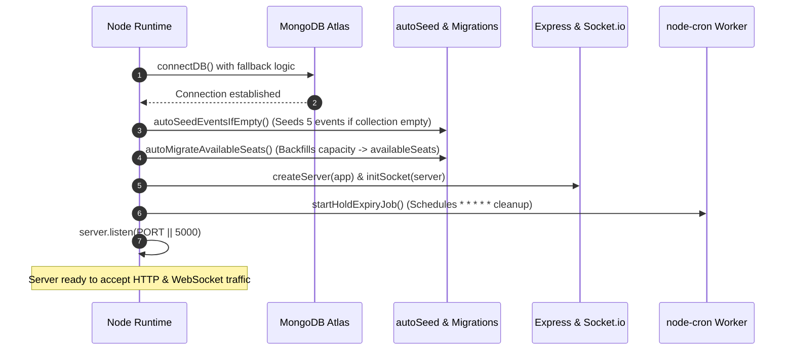

# File 05: Backend & API Walkthrough

This document explores the backend architecture, server lifecycle, middleware pipeline, and the complete REST API surface of EventSphere. Every endpoint is verified against the source code, detailing its HTTP method, URL pattern, authentication requirements, input schemas, business logic, response shapes, and failure status codes.

---

## 1. Server Boot Sequence

The backend boots from [backend/index.js](../../backend/index.js), executing an asynchronous initialization pipeline before opening network ports:



### Server Boot Steps Explained
1. **Environment Config**: `dotenv.config({ path: "./.env" })` loads environment secrets.
2. **Database Connection (`connectDB()`)**:
   - Inspects `MONGODB_URI` or `MONGO_URI`. If missing database name, appends `/${DB_NAME}` (`EventSphere`) ([db.js:7-13](../../backend/config/db.js#L7-L13)).
   - **Fault-Tolerant Fallback**: If the primary remote connection throws an exception (e.g., DNS error, Atlas IP whitelist block), it catches the error and retries with local MongoDB at `mongodb://localhost:27017/EventSphere` before giving up ([db.js:19-27](../../backend/config/db.js#L19-L27)).
3. **Data Bootstrapping (`autoSeedEventsIfEmpty()`)**:
   - Queries `Event.countDocuments()`. If 0, automatically creates a default organizer account (`organizer@eventsphere.com`) and seeds 5 rich sample events ([autoSeed.js:20-110](../../backend/utils/autoSeed.js)).
4. **Schema Migration (`autoMigrateAvailableSeats()`)**:
   - Queries events where `availableSeats` is missing or null, setting `availableSeats = capacity` to ensure backwards compatibility with older seed data.
5. **WebSocket & Worker Initialization**:
   - Wraps the Express app in a native Node `http.createServer(app)`.
   - Attaches Socket.io via `initSocket(server)`.
   - Starts the seat hold cleanup cron worker via `startHoldExpiryJob()`.
6. **Port Listener**: Binds to `process.env.PORT` (defaults to 5000).

---

## 2. Middleware Execution Order

In Express, middleware order is critical. In [backend/app.js](../../backend/app.js), the pipeline is assembled as follows:

```
[1] CORS (origin: true, credentials: true)
 └── [2] Body Parsers (express.json { limit: "16kb" }, express.urlencoded { limit: "16kb" })
      └── [3] Static Files (express.static("Public"))
           └── [4] Cookie Parser (cookieParser())
                ├── [5A] /api/v1/users (Protected by authLimiter: 100 req / 15m)
                ├── [5B] /api/v1/events (Event Router)
                ├── [5C] /api/v1/bookings (Protected by bookingLimiter: 5 mutations / 1m)
                ├── [5D] /api/v1/reviews (Review Router)
                ├── [5E] /api/v1/chat (Chat Router)
                └── [5F] /api/v1/contacts (Contact Router)
                     └── [6] Error Handling Middleware (errorMiddleware)
```

### Rate Limiting Rules
- **Authentication Limiter** (`authLimiter`): Applied globally to `/api/v1/users`. Allows 100 requests per 15-minute window per IP.
- **Booking Mutation Limiter** (`bookingLimiter`): Applied to `/api/v1/bookings`. Allows a maximum of 5 booking attempts per minute per user/IP. Skips `GET` requests (`skip: (req) => req.method === "GET"`) so live seat polling is never blocked ([app.js:24-36](../../backend/app.js#L24-L36)).

---

## 3. Standardized Request & Response Utilities

### 1. `ApiResponse` ([backend/utils/ApiResponse.js](../../backend/utils/ApiResponse.js))
Standardizes every successful JSON response:
```javascript
class ApiResponse {
  constructor(statusCode, data, message = "Success") {
    this.statusCode = statusCode;
    this.data = data;
    this.message = message;
    this.success = statusCode < 400;
  }
}
```

### 2. `ApiError` ([backend/utils/ApiError.js](../../backend/utils/ApiError.js))
Custom JavaScript error class for controlled HTTP exception throwing:
```javascript
class ApiError extends Error {
  constructor(statusCode, message = "Something went wrong", errors = [], stack = "") {
    super(message);
    this.statusCode = statusCode;
    this.data = null;
    this.errors = errors;
    this.success = false;
  }
}
```

### 3. `asyncHandler` ([backend/utils/asyncHandler.js](../../backend/utils/asyncHandler.js))
Higher-order function wrapping async route handlers:
```javascript
const asyncHandler = (requestHandler) => {
  return (req, res, next) => {
    Promise.resolve(requestHandler(req, res, next)).catch((err) => next(err));
  };
};
```

### 4. `errorMiddleware` ([backend/middlewares/error.middleware.js](../../backend/middlewares/error.middleware.js))
Terminal middleware that intercepts all errors passed to `next(err)`:
```javascript
const errorMiddleware = (err, req, res, next) => {
  const statusCode = err.statusCode || 500;
  res.status(statusCode).json({
    success: err.success || false,
    message: err.message || 'Internal Server Error',
    errors: err.errors || [],
    stack: process.env.NODE_ENV === 'development' ? err.stack : undefined,
  });
};
```

---

## 4. Complete API Route & Endpoint Reference

### 1. Users Router (`/api/v1/users`)
*Defined in [backend/routes/user.routes.js](../../backend/routes/user.routes.js) and implemented in [backend/controllers/user.controllers.js](../../backend/controllers/user.controllers.js)*

| Method | Endpoint | Auth Required | Request Body | Response & Status Code |
| :--- | :--- | :--- | :--- | :--- |
| `POST` | `/register` | None | `{ name, email, password, role? }` | `201 Created`: `{ user, accessToken, refreshToken }` |
| `POST` | `/login` | None | `{ email, password }` | `200 OK`: `{ user, accessToken, refreshToken }` + HTTP-only cookies |
| `POST` | `/logout` | Bearer / Cookie | None | `200 OK`: Clears auth cookies, removes DB refreshToken |
| `POST` | `/refresh-token` | None | `{ refreshToken? }` or cookie | `200 OK`: `{ accessToken, refreshToken: newRefreshToken }` |
| `GET` | `/profile` | Bearer / Cookie | None | `201 OK`: Current user profile (without password) |
| `POST` | `/change-password` | Bearer / Cookie | `{ oldPassword, newPassword }` | `201 Created`: `"Password Changed Successfully"` |
| `PATCH` | `/update-account` | Bearer / Cookie | `{ name, email }` | `201 Created`: Updated user document |

---

### 2. Events Router (`/api/v1/events`)
*Defined in [backend/routes/event.routes.js](../../backend/routes/event.routes.js) and implemented in [backend/controllers/event.controller.js](../../backend/controllers/event.controller.js)*

| Method | Endpoint | Auth Required | Request Body / Params | Response & Status Code |
| :--- | :--- | :--- | :--- | :--- |
| `GET` | `/all-events` | None | None | `200 OK`: All active events (`activeStatus != 'cancelled'`) with computed `status: "upcoming" \| "ongoing" \| "completed" \| "past"` |
| `GET` | `/event/:id` | None | Param: `:id` | `200 OK`: Single event with populated organizer details |
| `GET` | `/seed-demo` | None | None | `200 OK`: Seeds sample events if collection is empty |
| `POST` | `/create-event` | `organizer` / `admin` | `multipart/form-data`: `title, description, date, location, Price, category, capacity, locationGoogleMapLink`, file: `image` | `201 Created`: Newly created event document with Cloudinary image URL |
| `PATCH` | `/update-event/:id` | `organizer` / `admin` | `multipart/form-data`: Updated event fields, optional new `image` | `200 OK`: Updated event document |
| `GET` | `/analytics/:eventid` | `organizer` / `admin` | Param: `:eventid` | `200 OK`: MongoDB Aggregation `{ totalBookings, totalSeats, totalRevenue }` |
| `GET` | `/my-events` | `organizer` / `admin` | None | `200 OK`: Array of events organized by `req.user._id` |
| `PATCH` | `/cancel-event/:eventid` | `organizer` / `admin` | Param: `:eventid` | `200 OK`: Marks event and all child bookings `cancelled`, initiates Razorpay refund if applicable |
| `GET` | `/admin/all-events` | `admin` | None | `200 OK`: Returns all events across all statuses |
| `DELETE` | `/admin/delete-event/:id` | `admin` | Param: `:id` | `200 OK`: Deletes Cloudinary asset and MongoDB record |

---

### 3. Bookings Router (`/api/v1/bookings`)
*Defined in [backend/routes/booking.router.js](../../backend/routes/booking.router.js) and implemented in [backend/controllers/booking.controller.js](../../backend/controllers/booking.controller.js)*

| Method | Endpoint | Auth Required | Request Body / Params | Response & Status Code |
| :--- | :--- | :--- | :--- | :--- |
| `GET` | `/seat-availability/:eventId` | None | Param: `:eventId` | `200 OK`: `{ capacity, availableSeats, bookedSeats, heldSeats, effectiveFreeSeats, isSoldOut, fillingFast }` |
| `POST` | `/create-order/:eventId` | Bearer / Cookie | `{ selectedSeats: [String], usePoints?: Boolean, couponCode?: String, ticketTier?: String }` | `200 OK` (Stripe URL) or `201 Created` (Wallet full discount): Sets Redis hold, creates pending booking |
| `POST` | `/verify-payment` | Bearer / Cookie | `{ stripe_session_id, eventId, selectedSeats, discount, ticketTier, ticketPrice, bookingId }` | `201 Created`: Confirms hold, decrements MongoDB seats, generates HMAC QR code, credits cashback points |
| `GET` | `/my-bookings` | Bearer / Cookie | None | `200 OK`: Returns attendee's non-expired bookings sorted by newest |
| `DELETE` | `/cancel-booking/:bookingid` | Bearer / Cookie | Param: `:bookingid` | `200 OK`: Releases hold, restores MongoDB seats, updates status to `cancelled` |
| `GET` | `/admin/all-bookings` | `admin` | None | `200 OK`: Global booking ledger with user and event populated |
| `GET` | `/admin/event-bookings/:eventId` | `admin` | Param: `:eventId` | `200 OK`: Bookings for a specific event |
| `GET` | `/organizer/event-bookings/:eventId` | `organizer` | Param: `:eventId` | `200 OK`: Bookings for organizer's event |
| `POST` | `/checkin` | `organizer` | `{ payload, hash }` | `200 OK`: Validates HMAC signature, checks in ticket, sets `checkedIn: true` |

---

### 4. Reviews Router (`/api/v1/reviews`)
*Defined in [backend/routes/review.router.js](../../backend/routes/review.router.js) and implemented in [backend/controllers/review.controller.js](../../backend/controllers/review.controller.js)*

| Method | Endpoint | Auth Required | Request Body / Params | Business Rules & Response |
| :--- | :--- | :--- | :--- | :--- |
| `POST` | `/post-review/:eventId` | Bearer / Cookie | `{ rating: 1-5, comment }` | `201 Created`: Verified attendance required (`paymentstatus: "confirmed"`); event date must be in the past. Recomputes event `avgRating`. |
| `GET` | `/AllReviews/:eventId` | None | Param: `:eventId` | `200 OK`: Aggregates `{ average, totalReviews, reviews }`. |
| `PATCH` | `/edit/:reviewId` | Bearer / Cookie | `{ rating, comment }` | `200 OK`: Ownership verification; updates review and recomputes event `avgRating`. |
| `DELETE` | `/delete-review/:reviewId` | Bearer / Cookie | Param: `:reviewId` | `200 OK`: Ownership verification; deletes review and updates `avgRating`. |

---

### 5. Chat Router (`/api/v1/chat`)
*Defined in [backend/routes/chat.router.js](../../backend/routes/chat.router.js) and implemented in [backend/controllers/chat.controller.js](../../backend/controllers/chat.controller.js)*

| Method | Endpoint | Auth Required | Params | Response & Status Code |
| :--- | :--- | :--- | :--- | :--- |
| `GET` | `/chat-history/:eventId` | None (REST) | Param: `:eventId` | `200 OK`: Chronological list of chat messages with populated sender names. *(Note: Live WebSocket joins still require verified booking).* |

---

### 6. Contacts Router (`/api/v1/contacts`)
*Defined in [backend/routes/contact.router.js](../../backend/routes/contact.router.js) and implemented in [backend/controllers/contact.controller.js](../../backend/controllers/contact.controller.js)*

| Method | Endpoint | Auth Required | Body | Response & Status Code |
| :--- | :--- | :--- | :--- | :--- |
| `POST` | `/contact` | Bearer / Cookie | `multipart/form-data`: `name, email, subject, message`, optional file: `image` | `201 Created`: Saves inquiry document in MongoDB with Cloudinary proof link. |

---

## 5. Summary for Technical Interviews

> "EventSphere's backend runs on Express 5.1.0 on Node 20. The server boot sequence connects to MongoDB with an automatic local fallback, runs initial migrations and seed checks, initializes Socket.io on the native HTTP server, and starts a 60-second cron job for seat hold expirations. Middleware follows a strict lifecycle: CORS with credentials, 16kb payload limits, dual-tier rate limiters, cookie parsing, JWT authentication, and role-based access control. All controllers use an `asyncHandler` wrapper that catches async rejections and forwards them to a centralized `errorMiddleware`, returning uniform `ApiResponse` and `ApiError` payloads."
