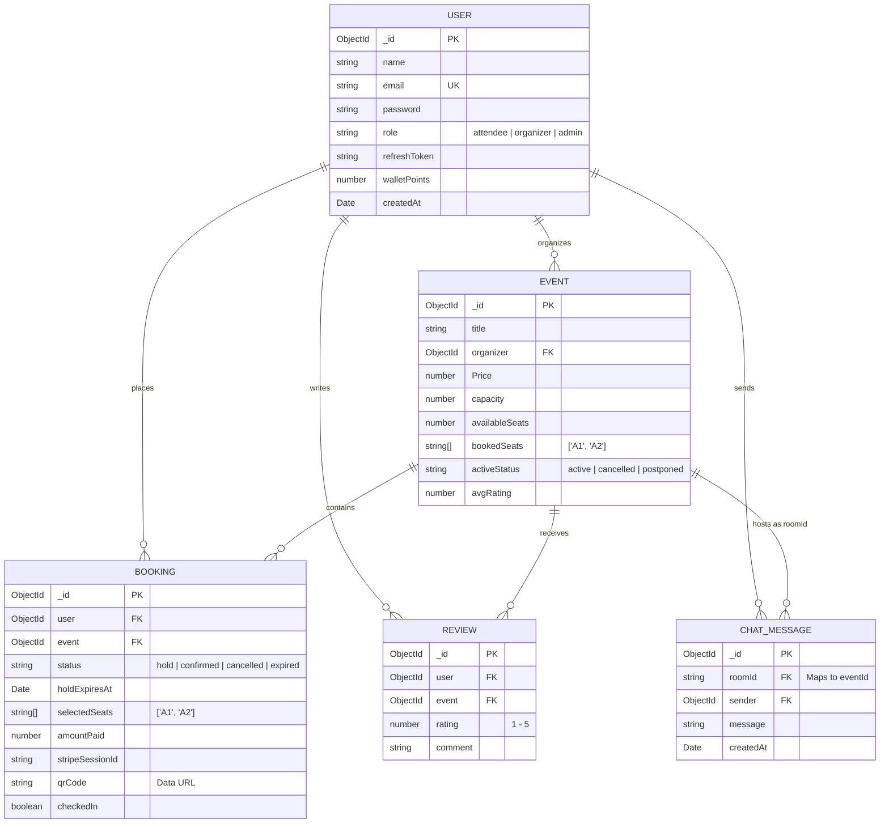

# File 06: Database (MongoDB) & Caching (Redis)

This document provides a deep dive into the persistence and caching architecture of EventSphere. It explores MongoDB Atlas schemas, relations, indexes, atomic operators, the unified Redis client adapter, TTL strategies, and concurrency safety guarantees.

---

## 1. Data Architecture Overview

EventSphere separates state across two specialized database technologies:

```
+-----------------------------------------------------------------------------------------+
|                                    DATA PERSISTENCE                                     |
|                                                                                         |
|  REDIS (In-Memory Key-Value Store)             MONGODB ATLAS (Document System of Record) |
|  • Ephemeral Seat Reservations                 • Persistent Entity Documents             |
|  • TTL: 1800 seconds (30 minutes)              • Schema Validation & Compound Indexes    |
|  • Sub-millisecond latency                     • Single-document atomic updates ($nin)   |
|  • Volatile (Cleared on confirmation/expiry)   • Permanent financial & ticket history    |
+-----------------------------------------------------------------------------------------+
```

---

## 2. MongoDB Collections & Schema Specifications

### 1. `User` Schema ([backend/models/user.model.js](../../backend/models/user.model.js))
Represents platform accounts across attendees, organizers, and administrators.

```javascript
// Field definitions & constraints
{
  name: { type: String, required: true, lowercase: true, trim: true },
  email: { type: String, unique: true, lowercase: true, trim: true, required: true },
  password: { type: String, required: true },
  role: { type: String, required: true, enum: ["attendee", "organizer", "admin"], default: "attendee" },
  refreshToken: { type: String },
  walletPoints: { type: Number, default: 0, min: [0, "Wallet points cannot be negative"] },
  timestamps: true // createdAt, updatedAt
}
```
- **Pre-Save Hook**: If `password` is modified, hashes the plaintext with `bcrypt.hash(password, 10)` ([user.model.js:43-47](../../backend/models/user.model.js#L43-L47)).
- **Instance Methods**:
  - `isPasswordCorrect(password)`: Compares candidate plaintext with bcrypt hash.
  - `genearteAccessToken()`: Returns signed JWT valid for `ACCESS_TOKEN_EXPIRY` (contains `_id`, `name`, `email`, `role`).
  - `refreshAccessToken()`: Returns signed JWT valid for `REFRESH_TOKEN_EXPIRY` (contains `_id`).

---

### 2. `Event` Schema ([backend/models/event.model.js](../../backend/models/event.model.js))
Represents scheduled experiences and maintains physical seat inventory.

```javascript
{
  title: { type: String, required: true, trim: true },
  description: { type: String, required: true, trim: true },
  date: { type: Date, required: true },
  location: { type: String, required: true, trim: true },
  locationGoogleMapLink: { type: String, required: true, trim: true },
  organizer: { type: Schema.Types.ObjectId, ref: "User", required: true },
  attendees: [
    {
      user: { type: Schema.Types.ObjectId, ref: "User", required: true },
      ticketsBooked: { type: Number, required: true, default: 1 }
    }
  ],
  image: { type: String, required: true, trim: true },
  Price: { type: Number, required: true, min: [0, "Price cannot be negative"] },
  ticketTypes: [
    {
      name: { type: String, default: "Standard Pass" },
      price: { type: Number, required: true },
      description: { type: String, default: "General Admission Pass" }
    }
  ],
  category: { type: String, enum: ["Movie", "Music", "Workshop", "Sports", "Other"], required: true, default: "other" },
  capacity: { type: Number, required: true, min: [1, "Capacity must be at least 1"] },
  availableSeats: { type: Number, min: [0, "Available seats cannot be negative"], default: undefined },
  bookedSeats: { type: [String], default: [] }, // Array of occupied seat IDs e.g. ["A1", "A2"]
  avgRating: { type: Number, default: 0 },
  activeStatus: { type: String, enum: ["active", "cancelled", "postponed"], required: true, default: "active" },
  timestamps: true
}
```
- **Pre-Save Hook**: If `isNew` and `availableSeats === undefined`, auto-initializes `availableSeats = capacity` ([event.model.js:104-109](../../backend/models/event.model.js#L104-L109)).
- **Indexes**:
  - `eventSchema.index({ availableSeats: 1 })`: Optimizes atomic seat queries and filtering.

---

### 3. `Booking` Schema ([backend/models/booking.model.js](../../backend/models/booking.model.js))
Acts as the authoritative ledger for transactions, seat reservations, and gate verification.

```javascript
{
  user: { type: Schema.Types.ObjectId, ref: "User", required: true },
  event: { type: Schema.Types.ObjectId, ref: "Event", required: true },
  bookingDate: { type: Date, default: Date.now },
  paymentstatus: { type: String, enum: ["confirmed", "cancelled", "pending"], default: "pending" },
  status: { type: String, enum: ["hold", "confirmed", "cancelled", "expired"], default: "hold", index: true },
  holdExpiresAt: { type: Date, index: true }, // Index for 60s cron job queries
  cancelDate: { type: Date },
  selectedSeats: { type: [String], default: [] },
  seatsBooked: { type: Number, default: 0 },
  stripeSessionId: { type: String },
  stripePaymentIntentId: { type: String },
  razorpayOrderId: { type: String },
  razorpayPaymentId: { type: String },
  razorpaySignature: { type: String },
  amountPaid: { type: Number },
  ticketTier: { type: String, default: "Standard Pass" },
  ticketPrice: { type: Number },
  qrCodeData: {
    payload: { type: String }, // Format: "bookingId:randomHex"
    hash: { type: String }     // HMAC-SHA256 digest
  },
  qrCode: { type: String },    // Base64 PNG data URL
  checkedIn: { type: Boolean, default: false },
  timestamps: true
}
```
- **Indexes**:
  - `status: 1`: Fast retrieval of active holds vs. confirmed bookings.
  - `holdExpiresAt: 1`: Critical index allowing the background worker to execute `{ status: "hold", holdExpiresAt: { $lte: new Date() } }` in sub-millisecond query time.

---

### 4. `Review` Schema ([backend/models/review.model.js](../../backend/models/review.model.js))
Stores post-event ratings and feedback.

```javascript
{
  user: { type: Schema.Types.ObjectId, ref: "User", required: true },
  event: { type: Schema.Types.ObjectId, ref: "Event", required: true },
  rating: { type: Number, required: true, min: 1, max: 5 },
  comment: { type: String, required: true, trim: true },
  timestamps: true
}
```
- **Compound Unique Index**:
  ```javascript
  // backend/models/review.model.js:29
  reviewSchema.index({ user: 1, event: 1 }, { unique: true });
  ```
  Guarantees at the database level that an attendee can submit **at most one review per event**. Attempting a second insert throws a MongoDB E11000 duplicate key error.

---

### 5. `ChatMessage` Schema ([backend/models/chatMessage.model.js](../../backend/models/chatMessage.model.js))
Stores persistent room messages for confirmed event communities.
```javascript
{
  roomId: { type: String, required: true }, // Maps to eventId string
  sender: { type: Schema.Types.ObjectId, ref: "User", required: true },
  message: { type: String, required: true },
  timestamps: true
}
```

---

## 3. Entity Relationship Diagram (ERD)



---

## 4. Redis Architecture & Concurrency Strategy

Redis manages high-throughput, short-lived locks during checkout, keeping write churn off MongoDB.

### 1. Redis Key Schema
```
seat_hold:{eventId}:{seatId}  ──>  userId  (String value)
TTL = 1800 seconds (30 minutes)
```

### 2. Three-Tier Client Adapter ([backend/utils/redisClient.js](../../backend/utils/redisClient.js))
EventSphere avoids hard vendor lock-in by wrapping its Redis interface in a unified client:
1. **Tier 1 — Upstash REST API (`@upstash/redis`)**:
   - Triggered when `UPSTASH_REDIS_REST_URL` and `UPSTASH_REDIS_REST_TOKEN` exist.
   - Operates over stateless HTTPS REST requests, ideal for serverless or Render/Vercel environments.
2. **Tier 2 — Standard Redis Protocol (`ioredis`)**:
   - Triggered when `REDIS_URL` exists.
   - Establishes a persistent TCP socket connection with a 5-second timeout and 3 connection retries.
3. **Tier 3 — In-Memory Map Fallback**:
   - Activated automatically if no Redis environment variables are found.
   - Emulates Redis commands (`set` with `nx` and `ex`, `get`, `del`, `keys`, `mget`) using JavaScript `Map` and `setTimeout`. Ensures zero friction during local development without Docker.

---

## 5. Atomic Operations & Race Condition Prevention

How does EventSphere guarantee that two concurrent requests for seat `A1` cannot both succeed?

### Layer 1: Redis Distributed Lock (`seatHold.js:46-71`)
```javascript
// backend/utils/seatHold.js:49
let locked = await redis.set(key, userId, { nx: true, ex: durationSecs });
```
- `NX: true` (Not Exists): The command succeeds **only if the key does not already exist**.
- If user 1 sets `seat_hold:101:A1`, Redis atomically records `userId_1`.
- When user 2 tries a millisecond later, `redis.set` returns `null`. The operation aborts and releases any partial holds acquired so far before throwing HTTP 409 Conflict.

### Layer 2: Atomic MongoDB Guard (`bookingLock.js:24-34`)
Even if the Redis cache was completely flushed or bypassed, MongoDB enforces a second mathematical lock using atomic document operators:

```javascript
// backend/utils/bookingLock.js:24-34
const updatedEvent = await Event.findOneAndUpdate(
  {
    _id: eventId,
    bookedSeats: { $nin: seatsArray }, // Guard: NONE of the seats can already be booked
  },
  {
    $push: { bookedSeats: { $each: seatsArray } },
    $inc: { availableSeats: -seatsArray.length },
  },
  { new: true }
);

if (!updatedEvent) {
  throw new ApiError(409, "One or more of your selected seats have just been booked.");
}
```
- **Why this is race-proof**: MongoDB guarantees document-level write atomicity. Even with 100 simultaneous requests hitting the same event document, MongoDB serializes updates. The first request finds `bookedSeats: { $nin: ["A1"] }` true, pushes `"A1"`, and succeeds. All subsequent 99 requests evaluate `$nin` against the updated array, find `"A1"` present, match 0 documents, and fail cleanly with HTTP 409.

---

## 6. Database Operations & Aggregations

### 1. Dynamic Rating Calculation ([backend/controllers/review.controller.js:42-48](../../backend/controllers/review.controller.js#L42-L48))
Whenever a review is created, edited, or deleted, EventSphere recalculates the event's `avgRating` using the aggregation pipeline:
```javascript
const stats = await Review.aggregate([
  { $match: { event: new mongoose.Types.ObjectId(eventId) } },
  { $group: { _id: "$event", avgRating: { $avg: "$rating" } } }
]);
await Event.findByIdAndUpdate(eventId, { avgRating: stats[0]?.avgRating || 0 });
```

### 2. Organizer Analytics Aggregation ([backend/controllers/event.controller.js:153-163](../../backend/controllers/event.controller.js#L153-L163))
Calculates real-time gross revenue and seat volumes for the organizer dashboard:
```javascript
const analytics = await Booking.aggregate([
  { $match: { event: event._id, paymentstatus: "confirmed" } },
  {
    $group: {
      _id: "$event",
      totalBookings: { $sum: 1 },
      totalSeats: { $sum: "$seatsBooked" },
      totalRevenue: { $sum: "$amountPaid" }
    }
  }
]);
```

---

## 7. Summary for Technical Interviews

> "EventSphere employs a polyglot persistence strategy pairing MongoDB Atlas with Redis. MongoDB serves as our system of record, utilizing Mongoose schemas with compound unique indexes (such as enforcing single reviews per user per event) and single-document atomic operations (`findOneAndUpdate` with `$nin` guards) to prevent double-booking. To protect database IOPS during flash sales, we implement a three-tier Redis caching layer that handles temporary seat holds with 30-minute TTLs using atomic `SET NX EX` commands. The Redis adapter supports Upstash REST for serverless, `ioredis` for TCP clusters, and an in-memory Map fallback for local testing."
