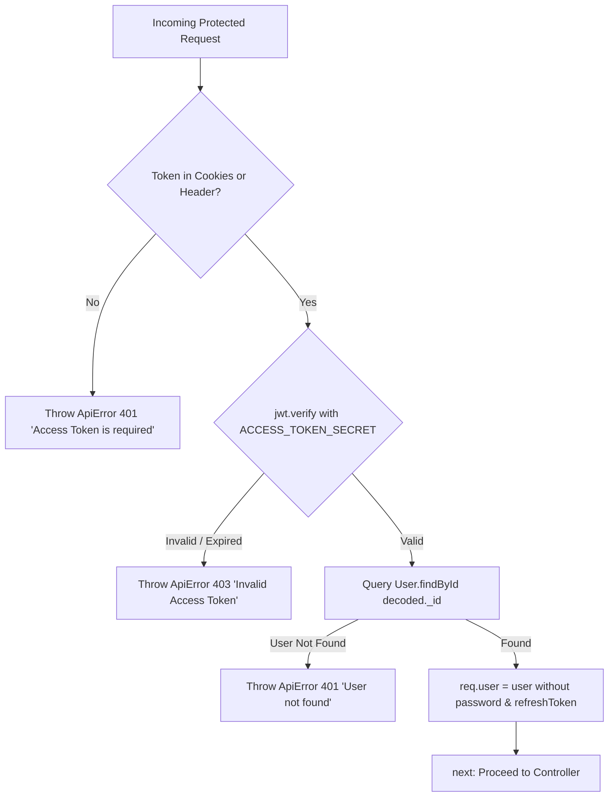

# File 07: Authentication, Authorization & Security

This document details the security architecture of EventSphere. It explores the dual-token JWT authentication flow, bcrypt password hashing, role-based access control (RBAC), HMAC cryptographic signatures on QR tickets, rate limiting, and security boundaries across the stack.

---

## 1. Authentication vs. Authorization

Before reviewing the code, it is essential to distinguish these two security concepts:

- **Authentication (AuthN) — "Who are you?"**:
  - The process of verifying an entity's claimed identity using credentials (email and password).
  - *EventSphere Implementation*: Handled by `loginUser` and `authMiddleware`. If valid, the server identifies the user and attaches their database record to `req.user`.
- **Authorization (AuthZ) — "What are you allowed to do?"**:
  - The process of verifying whether an authenticated user has permission to perform a specific action on a specific resource.
  - *EventSphere Implementation*: Handled by `authorizeRoles("organizer", "admin")` and resource ownership checks (e.g., verifying `event.organizer.toString() === req.user._id.toString()`).

---

## 2. Dual-Token JWT Architecture

EventSphere implements a dual-token JSON Web Token (JWT) system using `jsonwebtoken`:

```
+-----------------------------------------------------------------------------------------+
|                                  DUAL TOKEN LIFECYCLE                                   |
|                                                                                         |
|  ACCESS TOKEN                                    REFRESH TOKEN                          |
|  • Short-lived (Default: 1 day / '1d')           • Long-lived (Default: 10 days / '10d')|
|  • Signed with ACCESS_TOKEN_SECRET               • Signed with REFRESH_TOKEN_SECRET     |
|  • Carries user identity in payload              • Carries only user ID (_id)           |
|  • Transmitted on every API request              • Stored in DB (User.refreshToken)     |
|  • Sent via HTTP-only cookie or Bearer header    • Used exclusively at /refresh-token   |
+-----------------------------------------------------------------------------------------+
```

### 1. Token Payloads & Signing Methods ([backend/models/user.model.js:53-75](../../backend/models/user.model.js#L53-L75))
```javascript
// Access Token generation (backend/models/user.model.js:53-64)
userSchema.methods.genearteAccessToken = function () {
  return jwt.sign(
    {
      _id: this._id,
      name: this.name,
      email: this.email,
      role: this.role,
    },
    process.env.ACCESS_TOKEN_SECRET,
    { expiresIn: process.env.ACCESS_TOKEN_EXPIRY || "1d" }
  );
};

// Refresh Token generation (backend/models/user.model.js:66-75)
userSchema.methods.refreshAccessToken = function () {
  return jwt.sign(
    { _id: this._id },
    process.env.REFRESH_TOKEN_SECRET,
    { expiresIn: process.env.REFRESH_TOKEN_EXPIRY || "10d" }
  );
};
```

### 2. Cookie Security Options ([backend/controllers/user.controllers.js:67-70](../../backend/controllers/user.controllers.js#L67-L70))
When tokens are issued during login or refresh, they are set as cookies with security flags:
```javascript
const options = {
  httpOnly: true, // Prevents client-side JavaScript access (mitigates XSS token theft)
  secure: true,   // Transmitted only over encrypted HTTPS connections
};
res
  .status(200)
  .cookie("accessToken", accessToken, options)
  .cookie("refreshToken", refreshToken, options)
```

---

## 3. Password Security & Bcrypt Hashing

Plaintext passwords are never stored in the database. EventSphere leverages `bcryptjs` with salt round factor 10.

### 1. Automated Pre-Save Hashing Hook ([backend/models/user.model.js:43-47](../../backend/models/user.model.js#L43-L47))
```javascript
userSchema.pre("save", async function (next) {
  // Guard: Only re-hash if the password field was modified (prevents double-hashing on profile updates)
  if (!this.isModified("password")) return;
  this.password = await bcrypt.hash(this.password, 10);
});
```

### 2. Password Verification Method ([backend/models/user.model.js:49-51](../../backend/models/user.model.js#L49-L51))
```javascript
userSchema.methods.isPasswordCorrect = async function (password) {
  return await bcrypt.compare(password, this.password);
};
```

---

## 4. Authentication Middleware: `authMiddleware`

Implemented in [backend/middlewares/auth.middleware.js](../../backend/middlewares/auth.middleware.js):



### Token Extraction Logic
```javascript
// backend/middlewares/auth.middleware.js:7
const token = req.cookies?.accessToken || req.header("Authorization")?.replace("Bearer ", "");
```
This dual extraction allows the backend to support both browser environments with HTTP-only cookies and mobile/API clients using the `Authorization: Bearer <token>` standard.

---

## 5. Role-Based Access Control (RBAC): `authorizeRoles`

Implemented in [backend/middlewares/role.middleware.js](../../backend/middlewares/role.middleware.js):

```javascript
const authorizeRoles = (...roles) => {
  return asyncHandler(async (req, res, next) => {
    if (!req.user) {
      throw new ApiError(401, "User is not authenticated");
    }

    if (!roles.includes(req.user.role)) {
      throw new ApiError(403, `Role ${req.user.role} is not allowed to access this resource`);
    }

    next();
  });
};
```

### Role Permission Matrix

| Role | Browse Events | Book Tickets | Join Chat | Create Events | Access Analytics | Scan QR Check-in | Global Admin Deletes |
| :--- | :---: | :---: | :---: | :---: | :---: | :---: | :---: |
| **Guest** | Yes | No | No | No | No | No | No |
| **Attendee** | Yes | Yes | Yes (Booked) | No | No | No | No |
| **Organizer** | Yes | Yes | Yes (Booked) | Yes | Yes (Own Events) | Yes | No |
| **Admin** | Yes | Yes | Yes (Booked) | Yes | Yes (All Events) | Yes | Yes |

---

## 6. Cryptographic Ticket Verification: HMAC-SHA256

To prevent counterfeit tickets, screenshot manipulation, or attendees fabricating fake booking IDs, EventSphere utilizes **Hash-based Message Authentication Codes (HMAC)** using Node's native `crypto` module.

```
+-----------------------------------------------------------------------------------------+
|                               HMAC QR CODE GENERATION                                   |
|                                                                                         |
|  Payload = booking._id + ":" + crypto.randomBytes(8).toString("hex")                    |
|  Hash    = crypto.createHmac("sha256", QR_SECRET).update(Payload).digest("hex")         |
|  DataURL = qrcode.toDataURL(JSON.stringify({ payload: Payload, hash: Hash }))          |
+-----------------------------------------------------------------------------------------+
```

### 1. QR Generation ([backend/controllers/booking.controller.js:69-78](../../backend/controllers/booking.controller.js#L69-L78))
```javascript
async function generateSecureQRCode(booking) {
  const secretKey = process.env.QR_SECRET || "eventease_qr_secret_key_987654321";
  const qrPayload = `${booking._id}:${crypto.randomBytes(8).toString("hex")}`;
  const qrHash = crypto.createHmac("sha256", secretKey).update(qrPayload).digest("hex");

  booking.qrCodeData = { payload: qrPayload, hash: qrHash };
  const qrDataString = JSON.stringify({ payload: qrPayload, hash: qrHash });
  booking.qrCode = await QRcode.toDataURL(qrDataString);
  return booking;
}
```

### 2. Gate Verification ([backend/middlewares/qrScan.middleware.js:7-45](../../backend/middlewares/qrScan.middleware.js#L7-L45))
When the organizer scans an attendee's QR ticket at the door:
```javascript
const { payload, hash } = req.body;
const secretKey = process.env.QR_SECRET || "eventease_qr_secret_key_987654321";

// Recompute expected hash using server's private secret
const expectedHash = crypto
  .createHmac("sha256", secretKey)
  .update(payload)
  .digest("hex");

// 1. Cryptographic check: Tampering detection
if (hash !== expectedHash) {
  throw new ApiError(400, "Invalid QR code data");
}

// 2. Identity check: Extract bookingId
const bookingId = payload.split(":")[0];
const booking = await Booking.findById(bookingId);
if (!booking) throw new ApiError(404, "Booking not found");

// 3. Double-entry prevention: Check if already admitted
if (booking.checkedIn) {
  throw new ApiError(400, "User already checked in");
}

booking.checkedIn = true;
await booking.save();
res.status(200).json(new ApiResponse(200, booking, "Check-in successful"));
```

---

## 7. Rate Limiting & Abuse Prevention

Implemented via `express-rate-limit` in [backend/app.js:16-36](../../backend/app.js#L16-L36):

1. **Authentication Brute Force Protection (`authLimiter`)**:
   - Window: 15 minutes.
   - Max requests: 100.
   - Applied to: `/api/v1/users/*`.
2. **Anti-Hoarding & Bot Protection (`bookingLimiter`)**:
   - Window: 1 minute.
   - Max requests: 5 mutations per minute.
   - Key generator: Combines IP address with authenticated user ID:
     ```javascript
     keyGenerator: (req, res) => ipKeyGenerator(req, res) + (req.user?._id || "")
     ```
   - Safe GET Bypass: Allows users to refresh seat maps freely:
     ```javascript
     skip: (req) => req.method === "GET"
     ```

---

## 8. Security Limitations & Recommended Hardening

1. **Fallback Secret Keys**:
   - *Current Code*: If `process.env.QR_SECRET` is unset, the code falls back to `"eventease_qr_secret_key_987654321"`.
   - *Hardening*: Require hard failure on boot (`process.exit(1)`) if required secrets (`ACCESS_TOKEN_SECRET`, `REFRESH_TOKEN_SECRET`, `QR_SECRET`) are missing.
2. **Refresh Token Rotation**:
   - *Current Code*: Generates a new refresh token on `/refresh-token`, but does not implement an invalidation family table for detecting reuse.
   - *Hardening*: Track token family chains in Redis or MongoDB to revoke all sessions if a compromised refresh token is re-submitted.
3. **Constant-Time Hash Comparison**:
   - *Current Code*: `hash !== expectedHash` uses standard string equality, which is theoretically vulnerable to timing attacks.
   - *Hardening*: Use `crypto.timingSafeEqual(Buffer.from(hash), Buffer.from(expectedHash))`.

---

## 9. Summary for Technical Interviews

> "EventSphere enforces multi-layered defense in depth. Identity is established through dual JWT access and refresh tokens, with passwords protected using bcrypt (10 rounds) in pre-save hooks. Access control is maintained using declarative role-based middleware separating attendees, organizers, and admins. To stop ticket counterfeiting, tickets feature HMAC-SHA256 signatures over randomized payload strings, which the gate check-in middleware cryptographically validates before flipping a single-use `checkedIn` boolean. Brute-force and seat-hoarding bots are neutralized using dual express-rate-limiters that distinguish GET requests from mutations."
