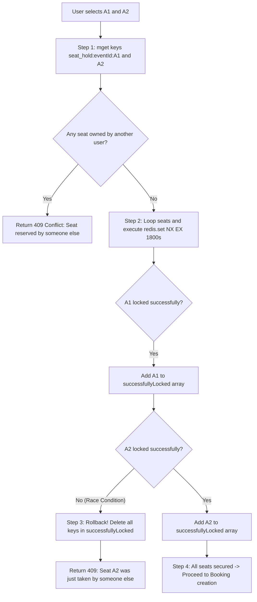
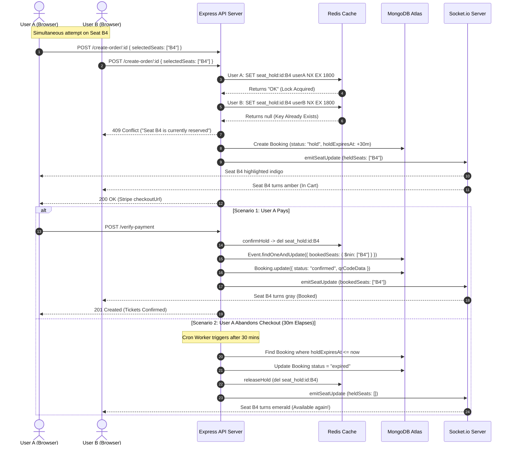

# File 08: Events, Bookings & Seat Reservations

This document details the core business engine of EventSphere: the event booking lifecycle and its **three-layer concurrency control architecture**. It explores how physical seats are selected, reserved in-memory via Redis, secured against simultaneous race conditions, committed atomically to MongoDB, and automatically recycled if abandoned during checkout.

---

## 1. The Ticketing Concurrency Problem

In ticketing systems like BookMyShow or Ticketmaster, thousands of users compete for the exact same physical seats during high-demand sales.

### The Race Condition Scenario
Imagine seat `B4` is the last available front-row seat.
- **10:00:00.100 AM**: User A requests seat `B4`.
- **10:00:00.105 AM**: User B requests seat `B4`.
- If the system simply checks `availableSeats > 0` and decrements later, both users will be granted checkout access, resulting in **overselling (double-booking)**.

```
Without Concurrency Control:
User A ──── Read available (1) ─────────────── Write booked (B4) ─── Success
User B ───────── Read available (1) ─────────────── Write booked (B4) ─── Double Booked! (BUG)
```

EventSphere prevents this with a **3-Layer Defense Model**:
1. **Layer 1 (Memory Lock)**: Redis `SET NX EX` holds the specific seat for 30 minutes.
2. **Layer 2 (Database Guard)**: MongoDB `findOneAndUpdate` with `$nin` ensures atomic serialization at the database layer.
3. **Layer 3 (Real-Time Broadcast)**: Socket.io instantly notifies all other active browsers to mark the seat as "In Cart" or "Booked".

---

## 2. Seat Availability Mathematics

To provide accurate visual indicators, EventSphere computes four seat quantities:

```
+-----------------------------------------------------------------------------------------+
|                                    SEAT MATHEMATICS                                     |
|                                                                                         |
|  Capacity (C)           = Total immutable physical seats in the venue                   |
|  Booked Seats (B)       = Array of permanently confirmed seat IDs in MongoDB            |
|  Held Seats (H)         = Array of active unexpired seat holds in Redis                 |
|  Available Seats (A)    = Decremented counter on Event document (Capacity - Confirmed)  |
|  Effective Free Seats   = Math.max(0, AvailableSeats - HeldSeats.length)                |
+-----------------------------------------------------------------------------------------+
```

### Verified Implementation in Code ([backend/controllers/booking.controller.js:469-491](../../backend/controllers/booking.controller.js#L469-L491))
```javascript
const getSeatAvailability = asyncHandler(async (req, res) => {
  const { eventId } = req.params;
  const event = await Event.findById(eventId).select("capacity availableSeats title bookedSeats");
  if (!event) throw new ApiError(404, "Event not found");

  const heldSeats = await getTotalHeldSeats(String(eventId)); // Array of seat IDs e.g. ["A1", "B4"]
  const effectiveFreeSeats = Math.max(0, (event.availableSeats ?? event.capacity) - heldSeats.length);

  res.status(200).json(
    new ApiResponse(200, {
      eventId,
      capacity: event.capacity,
      availableSeats: event.availableSeats ?? event.capacity,
      bookedSeats: event.bookedSeats || [],
      heldSeats: heldSeats || [],
      effectiveFreeSeats,
      isSoldOut: effectiveFreeSeats === 0 || event.bookedSeats?.length >= event.capacity,
      fillingFast: effectiveFreeSeats > 0 && effectiveFreeSeats <= event.capacity * 0.2,
    })
  );
});
```

---

## 3. The Interactive Seat Map

The client generates an interactive 10-column seating grid inside [src/Components/SeatMap.jsx](../../src/Components/SeatMap.jsx):

```javascript
// src/Components/SeatMap.jsx:21-28
const columns = 10;
const rows = Math.ceil(capacity / columns);

const getSeatId = (rowIndex, colIndex) => {
  const rowLetter = String.fromCharCode(65 + rowIndex); // A, B, C, D...
  const colNumber = colIndex + 1;                       // 1, 2, 3...
  return `${rowLetter}${colNumber}`;                   // e.g. "A1", "A2", "B10"
};
```

### Visual State Matrix
```
+---------------+------------------------+------------------------------------+--------------------------+
| Seat State    | Source of Truth        | Tailwind CSS Styling               | User Interaction         |
+---------------+------------------------+------------------------------------+--------------------------+
| Available     | Free in DB & Redis     | bg-white border-emerald-500        | Clickable -> Selected    |
| Selected      | Local Component State  | bg-indigo-500 text-white scale-110 | Clickable -> Deselect    |
| In Cart (Held)| Active in Redis        | bg-amber-100 border-amber-300      | Disabled (Occupied)      |
| Booked        | Event.bookedSeats (DB) | bg-slate-200 border-slate-300      | Disabled (Non-clickable) |
+---------------+------------------------+------------------------------------+--------------------------+
```

---

## 4. Layer 1: In-Memory Seat Holds (Redis)

When an attendee clicks "Checkout", the backend calls `holdSeats()` in [backend/utils/seatHold.js](../../backend/utils/seatHold.js#L26-L74).

```
Redis Key: seat_hold:{eventId}:{seatId}  ──>  userId
TTL: DEFAULT_HOLD_SECONDS = 1800 (30 minutes)
```

### The Multi-Seat Locking Algorithm ([seatHold.js:33-73](../../backend/utils/seatHold.js#L33-L73))
Holding multiple seats (e.g., `["A1", "A2"]`) introduces partial failure risks. What if `A1` is free, but `A2` was locked by someone else half a millisecond ago?



### Code Implementation with Rollback Mechanism
```javascript
// backend/utils/seatHold.js:46-71
const successfullyLocked = [];

for (let i = 0; i < keys.length; i++) {
  const key = keys[i];
  let locked = await redis.set(key, userId, { nx: true, ex: durationSecs });
  
  if (!locked) {
    // If key exists, check if current user is refreshing their own hold
    const owner = await redis.get(key);
    if (owner === userId) {
      await redis.set(key, userId, { ex: durationSecs }); // Refresh TTL
      locked = true;
    }
  }

  if (locked) {
    successfullyLocked.push(key);
  } else {
    // CRITICAL CONCURRENCY SAFEGUARD:
    // If any seat in the batch fails, release all previously locked seats in this batch!
    for (const lockedKey of successfullyLocked) {
      await redis.del(lockedKey);
    }
    return { success: false, heldSeats: 0, reason: `Seat ${seatsToHoldArray[i]} was just taken by someone else.` };
  }
}
```

---

## 5. Layer 2: Atomic MongoDB Commit Guard

Once payment succeeds, the application executes `atomicDecrementSeats()` in [backend/utils/bookingLock.js](../../backend/utils/bookingLock.js#L21-L49).

### Why Normal `find()` and `save()` Fail
```javascript
// NAIVE IMPLEMENTATION (VULNERABLE TO RACE CONDITIONS)
const event = await Event.findById(eventId);
event.bookedSeats.push(...seats); // Non-atomic read-modify-write!
await event.save();
```
If two processes execute `findById` concurrently, they will both read the same array, push their respective seats, and the second `save()` will overwrite the first.

### EventSphere's Atomic Guard ([bookingLock.js:24-34](../../backend/utils/bookingLock.js#L24-L34))
```javascript
const updatedEvent = await Event.findOneAndUpdate(
  {
    _id: eventId,
    bookedSeats: { $nin: seatsArray }, // Guard: NONE of the candidate seats can exist in bookedSeats
  },
  {
    $push: { bookedSeats: { $each: seatsArray } },
    $inc: { availableSeats: -seatsArray.length },
  },
  { new: true }
);

if (!updatedEvent) {
  throw new ApiError(
    409,
    `One or more of your selected seats for "${event.title}" have just been booked. Please choose different seats.`
  );
}
```
Because MongoDB guarantees document-level lock serialization, this single operation acts as a mutex. If any requested seat already exists in `bookedSeats`, the query selector evaluates to `null` and aborts safely.

---

## 6. Layer 3: Real-Time WebSocket Synchronization

Whenever a hold is acquired, confirmed, or released, the controller invokes `emitSeatUpdate(eventId)` ([booking.controller.js:49-66](../../backend/controllers/booking.controller.js#L49-L66)):

```javascript
io.to(`seats:${eventId}`).emit("seatUpdate", {
  eventId: String(eventId),
  availableSeats: event?.availableSeats ?? 0,
  bookedSeats: event?.bookedSeats || [],
  heldSeats: heldSeats || [],
  capacity: event?.capacity ?? 0,
  timestamp: new Date().toISOString(),
});
```
Every browser connected to that event's room immediately receives the payload, re-renders the seat colors, and disables the occupied seats without the user having to refresh their browser.

---

## 7. The Seat Hold Expiry Worker (Node-Cron)

When users abandon checkout (e.g., closing the tab or losing network connectivity), their reserved seats must return to the public inventory.

### Worker Architecture ([backend/jobs/holdExpiry.js](../../backend/jobs/holdExpiry.js))
- **Schedule**: `* * * * *` (Executes every 60 seconds).
- **Concurrency Lock**: `let isRunning = false;` prevents overlapping job executions if a cleanup cycle takes longer than 60 seconds.
- **Workflow**:
  1. Finds all expired hold bookings:
     ```javascript
     const expiredBookings = await Booking.find({
       status: "hold",
       holdExpiresAt: { $lte: new Date() },
     });
     ```
  2. Updates booking status to `expired` and `paymentstatus: "cancelled"`.
  3. Deletes seat keys from Redis (`releaseHold`).
  4. Restores seats to MongoDB (`atomicRestoreSeats`).
  5. Emits `seatUpdate` via Socket.io to repopulate the seat as available on all active attendee screens.

### Verified Code Nuance & Implementation Gap
> In `backend/jobs/holdExpiry.js:84`, the worker executes:
> ```javascript
> await atomicRestoreSeats(booking.event, booking.seatsBooked, event?.capacity);
> ```
> However, `atomicRestoreSeats` in `backend/utils/bookingLock.js:59` expects `(eventId, seatsArray)` where it calls `$pullAll: { bookedSeats: seatsArray }`. Passing `booking.seatsBooked` (a Number) causes `seatsArray.length` to be undefined.
> **Interview Insight**: This is a subtle discrepancy resulting from migrating from legacy capacity counters to discrete seat map arrays. To fix it, change line 84 to pass `booking.selectedSeats` (the array of seat strings).

---

## 8. End-to-End Sequence Diagram



---

## 9. Summary for Technical Interviews

> "EventSphere implements a BookMyShow-style three-layer concurrency control architecture. During seat selection, the client renders an interactive 10-column grid derived from event capacity. When checkout starts, Layer 1 executes an atomic Redis `SET NX EX` lock across all selected seats for 30 minutes, rolling back the entire batch if any seat is already held. Layer 2 guards the database during payment verification using MongoDB's `findOneAndUpdate` with a `$nin` filter on the `bookedSeats` array, ensuring mathematical write serialization. Layer 3 synchronizes state across all connected clients via Socket.io broadcasts. If an attendee abandons checkout, a 60-second Node-Cron worker identifies expired holds, restores inventory, and notifies all connected clients."
