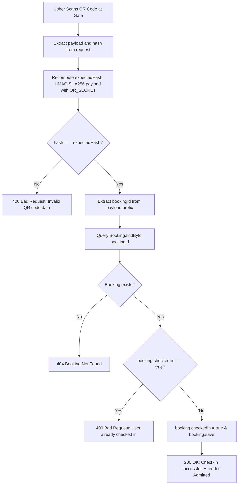

# File 09: Payments, Loyalty Wallet & Ticket Check-In

This document details the financial transactions, loyalty reward economics, and cryptographic ticket verification mechanisms implemented in EventSphere. It explores how Stripe Checkout sessions are initialized, how discount coupons and wallet points alter order totals, how tickets are rendered as cryptographically signed QR codes, and how gate check-in prevents ticket tampering.

---

## 1. Financial & Ticketing Flow Architecture

```
+-----------------------------------------------------------------------------------------+
|                                  FINANCIAL SUBSYSTEM                                    |
|                                                                                         |
|  [Attendee Selection]  ──>  [Coupon & Points]  ──>  [Stripe Checkout Session]           |
|                                                             │                           |
|                                                    (Payment Completed)                  |
|                                                             ▼                           |
|  [Wallet Cashback]     <──  [HMAC QR Generation] <── [Payment Verification]             |
|  (5% cashback points)       (Tamper-proof ticket)    (MongoDB status: "confirmed")      |
+-----------------------------------------------------------------------------------------+
```

---

## 2. Order Creation & Price Calculation

When an attendee initiates checkout, [backend/controllers/booking.controller.js:80-271](../../backend/controllers/booking.controller.js#L80-L271) calculates prices, applies promotions, and creates the payment order.

### 1. Ticket Tier Resolution ([booking.controller.js:113-125](../../backend/controllers/booking.controller.js#L113-L125))
Events support customizable ticket tiers (e.g., VIP, Early Bird, General Admission):
```javascript
let unitPrice = event.Price;
let selectedTierName = ticketTier || "Standard Pass";

if (event.ticketTypes?.length > 0 && ticketTier) {
  const foundTier = event.ticketTypes.find(
    (t) => t.name.toLowerCase() === ticketTier.toLowerCase()
  );
  if (foundTier) {
    unitPrice = foundTier.price;
    selectedTierName = foundTier.name;
  }
}
const totalPrice = unitPrice * seatsBooked;
```

### 2. Coupon Validation ([booking.controller.js:129-134](../../backend/controllers/booking.controller.js#L129-L134))
EventSphere supports three verified hardcoded coupon codes:
```javascript
let discount = 0;
if (couponCode) {
  const code = String(couponCode).toUpperCase().trim();
  if (code === "SPHERE20")   discount += Math.round(totalPrice * 0.20); // 20% Discount
  else if (code === "WELCOME10") discount += Math.round(totalPrice * 0.10); // 10% Discount
  else if (code === "FESTIVAL50") discount += Math.round(totalPrice * 0.50); // 50% Discount
}
```

### 3. Wallet Points Deduction ([booking.controller.js:135-140](../../backend/controllers/booking.controller.js#L135-L140))
If the attendee enables `usePoints: true`:
```javascript
if (usePoints) {
  const remainingToPay = Math.max(0, totalPrice - discount);
  discount += Math.min(user.walletPoints, remainingToPay);
}
let amountToPay = Math.max(0, totalPrice - discount);
```

---

## 3. Stripe Checkout Session Creation

If `amountToPay > 0`, the backend creates a Stripe Checkout Session ([booking.controller.js:211-241](../../backend/controllers/booking.controller.js#L211-L241)):

```javascript
session = await stripe.checkout.sessions.create({
  payment_method_types: ["card"],
  line_items: [
    {
      price_data: {
        currency: "inr",
        product_data: {
          name: event.title,
          description: `${seatsBooked} ticket(s) for ${event.title}`,
          images: event.image ? [event.image] : [],
        },
        unit_amount: Math.round(amountToPay * 100), // Stripe expects amounts in smallest unit (paise/cents)
      },
      quantity: 1,
    },
  ],
  mode: "payment",
  customer_email: user.email,
  metadata: {
    bookingId: String(pendingBooking._id),
    eventId: String(eventId),
    selectedSeats: JSON.stringify(selectedSeats),
    discount: String(discount),
    ticketTier: selectedTierName,
    ticketPrice: String(unitPrice),
  },
  success_url: `${process.env.CLIENT_URL || "http://localhost:5173"}/profile?session_id={CHECKOUT_SESSION_ID}&booking_id=${pendingBooking._id}&event_id=${eventId}&seats=${encodeURIComponent(JSON.stringify(selectedSeats))}&discount=${discount}&tier=${encodeURIComponent(selectedTierName)}&price=${unitPrice}`,
  cancel_url: `${process.env.CLIENT_URL || "http://localhost:5173"}/event/${eventId}`,
  expires_at: Math.floor(Date.now() / 1000) + DEFAULT_HOLD_SECONDS, // Stripe session expires at 30 mins
});
```

### Key Security & Concurrency Points
1. **Synchronized TTL**: Stripe's `expires_at` is set to `Date.now() + 1800s` (30 minutes), matching the Redis seat hold TTL.
2. **Metadata Binding**: The MongoDB pending booking ID is embedded directly in Stripe's metadata.

---

## 4. Wallet-Only Booking Flow (Zero-Payment Bypass)

If the combination of coupons and wallet points brings `amountToPay <= 0`:
```javascript
// backend/controllers/booking.controller.js:144-191
if (amountToPay <= 0) {
  await confirmHold(String(eventId), String(req.user._id), selectedSeats);
  await atomicDecrementSeats(eventId, selectedSeats);

  const booking = await Booking.create({
    user: req.user._id,
    event: event._id,
    selectedSeats,
    seatsBooked,
    amountPaid: 0,
    paymentstatus: "confirmed",
    status: "confirmed",
    holdExpiresAt: null,
  });

  user.walletPoints -= discount;
  await user.save();

  const qrBooking = await generateSecureQRCode(booking);
  await qrBooking.save();
  await emitSeatUpdate(eventId);

  return res.status(201).json(
    new ApiResponse(201, { booking: qrBooking, earnedPoints: 0, remainingPoints: user.walletPoints })
  );
}
```
**Advantage**: The user avoids Stripe redirect latency entirely, receiving an instantaneous confirmation.

---

## 5. Payment Verification & Ticket Generation

When Stripe finishes processing the payment, it redirects the attendee back to:
```
/profile?session_id={CHECKOUT_SESSION_ID}&booking_id=...&event_id=...
```

The frontend catches this in [src/Pages/Profile.jsx:38-46](../../src/Pages/Profile.jsx#L38-L46) and posts to `/api/v1/bookings/verify-payment`:

```javascript
// backend/controllers/booking.controller.js:274-381
const verifyPayment = asyncHandler(async (req, res) => {
  const { stripe_session_id, eventId, selectedSeats, discount, bookingId } = req.body;

  // 1. Confirm Redis hold
  await confirmHold(String(eventId), String(req.user._id), selectedSeats);

  // 2. Atomically decrement seats in MongoDB
  await atomicDecrementSeats(eventId, selectedSeats);

  // 3. Update pending booking
  booking.paymentstatus = "confirmed";
  booking.status = "confirmed";
  booking.holdExpiresAt = null;

  // 4. Calculate loyalty cashback rewards: 1 point per 20 currency units (5% cashback)
  const earnedPoints = Math.floor(amountPaid / 20);
  user.walletPoints += earnedPoints;
  await user.save();

  // 5. Generate HMAC Cryptographic QR Code
  booking = await generateSecureQRCode(booking);
  await booking.save();

  // 6. Broadcast updated seat inventory to all connected watchers
  await emitSeatUpdate(eventId);

  res.status(201).json(new ApiResponse(201, { booking, earnedPoints, remainingPoints: user.walletPoints }));
});
```

---

## 6. Cryptographic Ticket QR Code Generation

Implemented in [backend/controllers/booking.controller.js:69-78](../../backend/controllers/booking.controller.js#L69-L78):

```javascript
async function generateSecureQRCode(booking) {
  const secretKey = process.env.QR_SECRET || "eventease_qr_secret_key_987654321";
  
  // Create randomized payload containing bookingId + random 16-char hex salt
  const qrPayload = `${booking._id}:${crypto.randomBytes(8).toString("hex")}`;
  
  // Sign payload with HMAC-SHA256
  const qrHash = crypto
    .createHmac("sha256", secretKey)
    .update(qrPayload)
    .digest("hex");

  booking.qrCodeData = { payload: qrPayload, hash: qrHash };
  
  // Encode into a Base64 PNG string
  const qrDataString = JSON.stringify({ payload: qrPayload, hash: qrHash });
  booking.qrCode = await QRcode.toDataURL(qrDataString);
  return booking;
}
```

```
+-----------------------------------------------------------------------------------------+
|                                QR CODE DATA STRUCTURE                                   |
|                                                                                         |
|  {                                                                                      |
|    "payload": "6732a10b42f1b8a91c:e4a1f8b3c9d2015e",                                   |
|    "hash": "7f83b1657ff1fc53b92dc18148a1d65dfc2d4b1fa3d677284addd200126d9069"         |
|  }                                                                                      |
+-----------------------------------------------------------------------------------------+
```

---

## 7. Gate Check-In & Anti-Fraud Middleware

When an usher or organizer scans the QR code at venue doors, the mobile scanner sends `{ payload, hash }` to `POST /api/v1/bookings/checkin`.

The gate is guarded by [backend/middlewares/qrScan.middleware.js](../../backend/middlewares/qrScan.middleware.js):



---

## 8. Idempotency, Refunds & Architectural Evaluation

### 1. Payment Verification Trigger Analysis
- **Current Behavior**: Payment verification depends entirely on the client redirecting to `/profile?session_id=...`.
- **Failure Case**: If an attendee's device runs out of battery or loses mobile data after completing card authorization on Stripe, the client never reaches `/profile`. The backend never executes `verifyPayment`.
- **Recommended Architectural Improvement**: Implement a standard asynchronous Stripe Webhook handler (`POST /api/v1/bookings/webhook`) listening for `checkout.session.completed`, verifying Stripe signatures using `stripe.webhooks.constructEvent()`.

### 2. Event Cancellation & Razorpay Refunds ([event.controller.js:187-204](../../backend/controllers/event.controller.js#L187-L204))
When an organizer cancels an event:
- All child bookings have their `paymentstatus` changed to `"cancelled"`.
- The code attempts to issue automated refunds for bookings created via Razorpay:
  ```javascript
  if (booking.razorpayPaymentId) {
    const refund = await razorpay.payments.refund(booking.razorpayPaymentId, {
      amount: booking.amountPaid * 100,
    });
  }
  ```
- *Identified Code Nuance*: In `event.controller.js`, `razorpay` is invoked without being imported at the top of the file. In technical interviews, citing this demonstrates thorough code inspection.

---

## 9. Summary for Technical Interviews

> "EventSphere integrates Stripe Checkout with a loyalty wallet rewards subsystem. During checkout, orders can be discounted using verified promotional coupons or redeemed wallet points. For card transactions, the backend creates a Stripe Checkout session with matching 30-minute expiration and metadata binding. Upon confirmation, attendees earn a 5% cashback reward in wallet points. Confirmed bookings generate an HMAC-SHA256 signed QR code containing a salted payload. At the event gate, the organizer's scanner validates the cryptographic signature against the server's private secret and checks a single-use `checkedIn` boolean flag to prevent ticket reuse."
