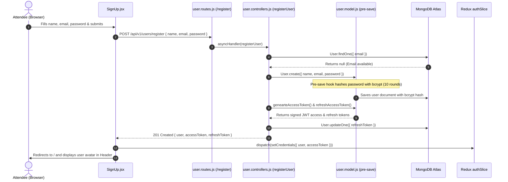
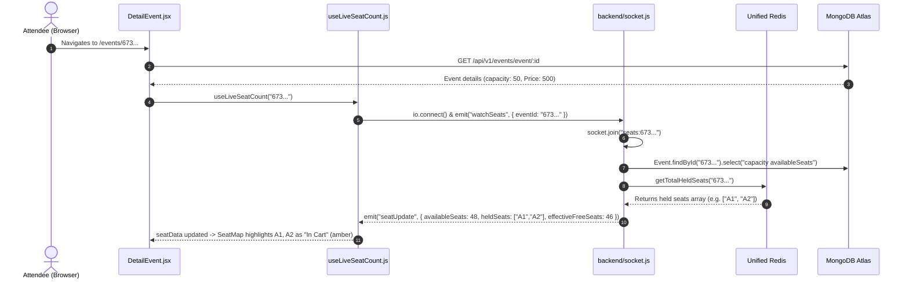
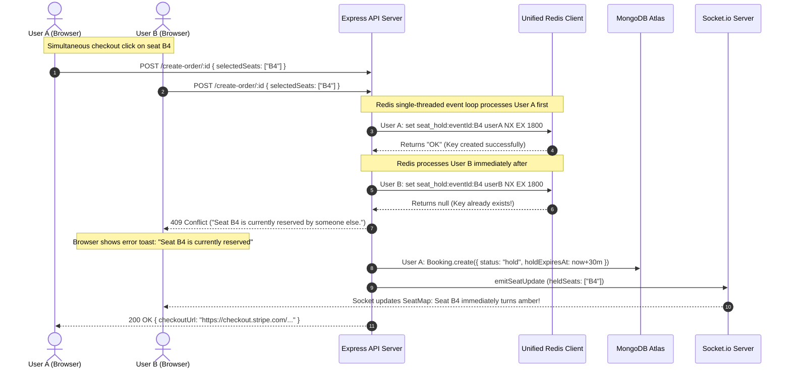
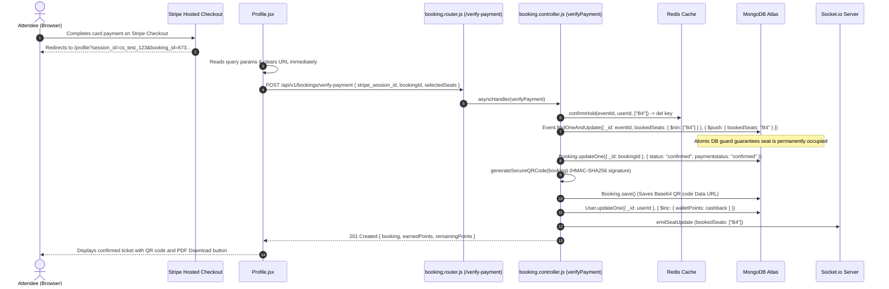
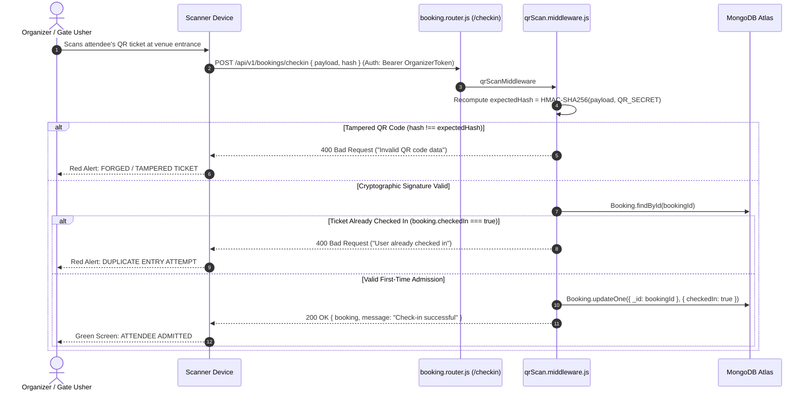
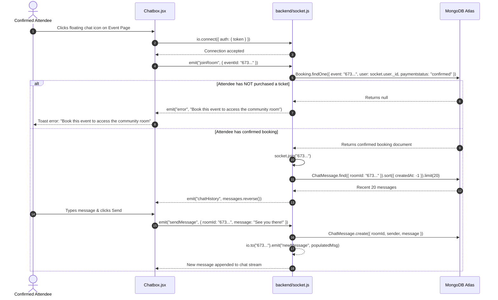
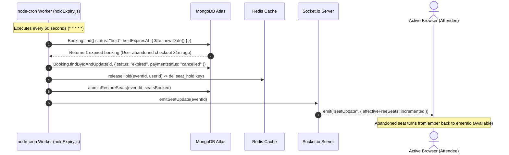

# File 12: End-to-End Feature Traces

This document traces seven end-to-end features through EventSphere. For each trace, we follow the execution path from the user's initial interaction in the browser, through frontend components and HTTP/WebSocket transports, into Express middleware and controllers, down to Redis and MongoDB, and back to the client interface.

---

## 1. Trace 1: User Registration & Session Rehydration

### Code Execution Breakdown
1. **Frontend Dispatch**: In [src/Components/Signup/SignUp.jsx:32](../../src/Components/Signup/SignUp.jsx#L32), the user submits credentials. `registerUser()` calls `axiosInstance.post("/api/v1/users/register")`.
2. **Backend Validation & Hashing**: In [backend/controllers/user.controllers.js:23-50](../../backend/controllers/user.controllers.js#L23-L50), `registerUser` verifies non-empty fields and checks email uniqueness. `User.create()` triggers the Mongoose pre-save hook in [backend/models/user.model.js:43-47](../../backend/models/user.model.js#L43-L47) which hashes the password using `bcrypt.hash(password, 10)`.
3. **Token Generation**: Controller invokes `user.genearteAccessToken()` (1-day expiry) and `user.refreshAccessToken()` (10-day expiry), stores the refresh token in MongoDB, and returns the user object (excluding the password) with status 201.
4. **Client Rehydration**: The response payload triggers `dispatch(setCredentials(...))` in [src/store/authslice.js:15](../../src/store/authslice.js#L15), writing the access token to `localStorage` and updating Redux state so the header immediately displays the user's initial.

---

## 2. Trace 2: Live Seat Watching on Event Page

### Code Execution Breakdown
1. **Hook Mounting**: On entering [src/Pages/DetailEvent.jsx:31](../../src/Pages/DetailEvent.jsx#L31), `useLiveSeatCount(id)` executes inside [src/hooks/useLiveSeatCount.js](../../src/hooks/useLiveSeatCount.js).
2. **WebSocket Handshake**: Connects to the server, passing optional auth headers. In [backend/socket.js:21-44](../../backend/socket.js#L21-L44), `io.use()` verifies identity or defaults `socket.user = null` for anonymous seat watchers.
3. **Room Subscription**: Hook emits `watchSeats({ eventId })`. The server joins the socket to `seats:${eventId}`, inspects Redis via `getTotalHeldSeats()`, calculates `effectiveFreeSeats`, and emits back an immediate `seatUpdate` snapshot ([backend/socket.js:57-89](../../backend/socket.js#L57-L89)).
4. **UI State Render**: The hook updates state, causing [src/Components/SeatMap.jsx](../../src/Components/SeatMap.jsx) to disable seats in `heldSeats` and color them amber.

---

## 3. Trace 3: High-Concurrency Seat Selection & Race Condition

What happens when two users click "Checkout" for the exact same seat (`B4`) at the exact same millisecond?

### Code Execution Breakdown
1. **Parallel Requests**: User A and User B submit `POST /api/v1/bookings/create-order/:id` with `selectedSeats: ["B4"]`.
2. **Atomic In-Memory Check**: In [backend/utils/seatHold.js:46-71](../../backend/utils/seatHold.js#L46-L71), `holdSeats()` calls `redis.set(key, userId, { nx: true, ex: 1800 })`.
3. **Deterministic Separation**: Redis evaluates commands sequentially. User A's command executes first, finds no key, writes `userA`, and returns `"OK"`. User B's command evaluates a fraction of a millisecond later, sees the key exists, and returns `null`.
4. **Conflict Handling**: User B's loop enters line 65, executes rollback cleanup (if multi-seat), and returns `{ success: false, reason: "Seat B4 is currently reserved" }`. In [backend/controllers/booking.controller.js:108-110](../../backend/controllers/booking.controller.js#L108-L110), this throws `ApiError(409)`, returning HTTP 409 Conflict.
5. **Real-time Sync**: User A's order triggers `emitSeatUpdate(eventId)`, broadcasting the new hold across WebSockets so User B's seat map turns amber in real time.

---

## 4. Trace 4: Stripe Payment & Ticket Confirmation

### Code Execution Breakdown
1. **Hosted Payment**: Attendee completes card authorization on Stripe. Stripe redirects browser to `${CLIENT_URL}/profile?session_id={CHECKOUT_SESSION_ID}...` ([booking.controller.js:238](../../backend/controllers/booking.controller.js#L238)).
2. **Client Redirection Catch**: In [src/Pages/Profile.jsx:22-59](../../src/Pages/Profile.jsx#L22-L59), `useEffect` catches `session_id`, clears search parameters via `setSearchParams({})` to prevent duplicate submissions on page refresh, and posts to `/verify-payment`.
3. **Atomic MongoDB Lock**: In [backend/utils/bookingLock.js:24-34](../../backend/utils/bookingLock.js#L24-L34), `atomicDecrementSeats` executes `$push: { bookedSeats: { $each: seatsArray } }` with a conditional filter `{ bookedSeats: { $nin: seatsArray } }`.
4. **Cryptographic Ticket Signing**: In [backend/controllers/booking.controller.js:69-78](../../backend/controllers/booking.controller.js#L69-L78), `generateSecureQRCode` generates an HMAC-SHA256 signature over `bookingId:randomHex` using `QR_SECRET` and saves the Base64 PNG data URL to `booking.qrCode`.
5. **Cashback Credit**: Awards 5% cashback in wallet points: `earnedPoints = Math.floor(amountPaid / 20)` ([booking.controller.js:355](../../backend/controllers/booking.controller.js#L355)).

---

## 5. Trace 5: Gate Check-In & Anti-Fraud Scan

### Code Execution Breakdown
1. **Scanner Dispatch**: The scanner decodes the JSON payload from the attendee's ticket: `{ payload: "6732...:a1f8...", hash: "7f83..." }` and submits a POST request to `/api/v1/bookings/checkin`.
2. **Cryptographic Integrity Check**: In [backend/middlewares/qrScan.middleware.js:15-22](../../backend/middlewares/qrScan.middleware.js#L15-L22), the server computes an HMAC-SHA256 digest over `payload` using the server's private `process.env.QR_SECRET`. If the result does not match `hash`, it rejects the request immediately.
3. **Single-Use Check**: Fetches the booking document and checks `if (booking.checkedIn)`. If true, it throws `ApiError(400, "User already checked in")`, preventing ticket sharing or duplicate entry.
4. **Admission**: Sets `booking.checkedIn = true`, commits to MongoDB, and returns HTTP 200.

---

## 6. Trace 6: Gated Attendee Community Chat

### Code Execution Breakdown
1. **Chat Activation**: Attendee opens `<ChatBox eventId={id} />` in [src/Components/Chatbox/Chatbox.jsx](../../src/Components/Chatbox/Chatbox.jsx).
2. **Access Verification**: In [backend/socket.js:97-125](../../backend/socket.js#L97-L125), `socket.on("joinRoom")` executes a MongoDB query verifying that a confirmed booking exists for that user and event.
3. **Rejection or History Injection**: Unconfirmed users receive an `error` event. Confirmed ticket holders join the room and receive the previous 20 messages via `chatHistory`.
4. **Message Broadcasting**: On `sendMessage`, the server verifies room membership, saves the document to MongoDB, and broadcasts `newMessage` to all connected attendees in the room.

---

## 7. Trace 7: Hold Expiration & Background Recycling

### Code Execution Breakdown
1. **Cron Trigger**: In [backend/jobs/holdExpiry.js:111-115](../../backend/jobs/holdExpiry.js#L111-L115), `cron.schedule("* * * * *", processExpiredHolds)` fires every minute.
2. **Expired Hold Query**: Queries `Booking` documents where `status == "hold"` and `holdExpiresAt <= new Date()` utilizing the index on `holdExpiresAt`.
3. **Resource Restoration**:
   - Marks booking `status = "expired"`.
   - Calls `releaseHold()` to delete Redis keys.
   - Calls `atomicRestoreSeats()` to restore inventory.
4. **Live Inventory Repopulation**: Dispatches `emitSeatUpdate(eventId)` across Socket.io so browsing attendees instantly see the returned seats become clickable again.

---

## 8. Summary for Technical Interviews

> "EventSphere coordinates transactions across multiple synchronized layers. For example, during seat reservations, a client submission executes an atomic Redis `SET NX EX` hold with rollback on partial failures, writes a pending booking document with a 30-minute expiration, and generates a synchronized Stripe session. Following checkout, client verification confirms the hold, triggers a MongoDB atomic `$nin` push operation to prevent database-level double bookings, issues an HMAC-SHA256 signed QR ticket, and credits loyalty cashback. If a checkout is abandoned, a 60-second cron job recycles the seats, and Socket.io broadcasts the freed inventory back to all active browsers."
